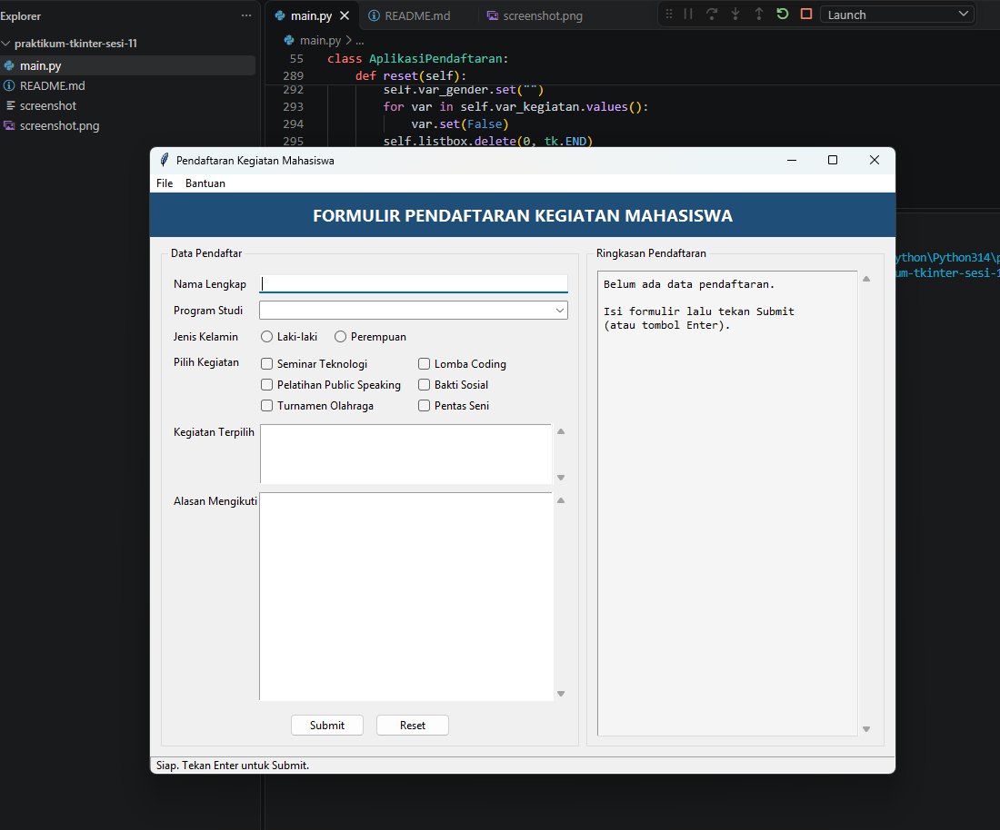

# Praktikum Tkinter Sesi 11 - Pendaftaran Kegiatan Mahasiswa

## Tujuan
Membangun aplikasi GUI menggunakan Python Tkinter dengan memanfaatkan berbagai
widget, event handling, validasi input, menu, dan dialog.

## Fitur
- **Entry** untuk nama, **Combobox** untuk program studi, **Radiobutton** untuk jenis kelamin.
- **Checkbutton** untuk memilih kegiatan, dengan **Listbox** yang menampilkan kegiatan terpilih secara langsung.
- **Text** untuk alasan mengikuti kegiatan.
- Tombol **Submit** dan **Reset**; ringkasan pendaftaran tampil pada area informasi.
- **Validasi**: nama tidak boleh kosong; prodi, jenis kelamin, minimal satu kegiatan, dan alasan juga wajib diisi. Kesalahan ditampilkan lewat **Messagebox** dan fokus dipindah ke kolom yang bermasalah.
- **Menu File** (Reset Formulir, Keluar) dan **Menu Bantuan** (Tentang Aplikasi) yang membuka jendela **Toplevel** About.
- **Event keyboard**: `Enter` menjalankan Submit (di kolom Text gunakan `Ctrl+Enter`), `Ctrl+R` reset, `Ctrl+Q` keluar, `F1` membuka About.
- Tata letak memakai **Frame/LabelFrame** dengan geometry manager `pack` dan `grid`.

## Cara Menjalankan
Syarat: Python 3.8+ (Tkinter sudah termasuk pada instalasi Python standar; di Linux: `sudo apt install python3-tk`).

```bash
git clone https://github.com/<radyaabdullah5>/praktikum-tkinter-sesi-11.git
cd praktikum-tkinter-sesi-11
python main.py
```

## Screenshot


## Struktur Berkas
```
praktikum-tkinter-sesi-11/
├── main.py
├── README.md
└── screenshot.png
```